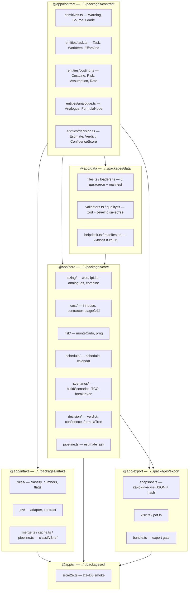
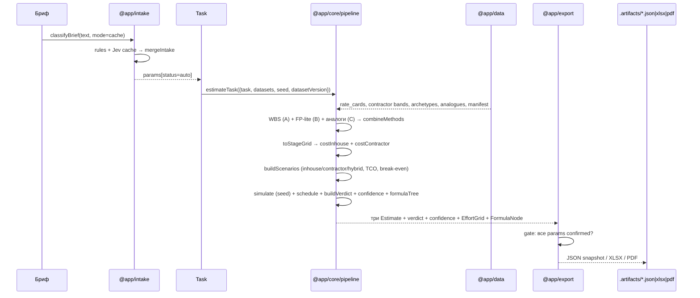
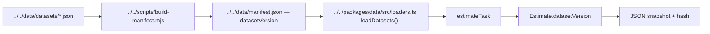

# ARCHITECTURE — пакеты и поток данных

Архитектура — это **чистое ядро + CLI/экспорт**, без сервера и без вычислений в
браузере. Подробности модели — `METHOD.md`, `DATA_MODEL.md`; контракт фронта —
`../../docs/09_integration_contract.md`.

## 1. Пакеты

Правила зависимостей (`../../packages/*/package.json`):

- `@app/contract` не зависит ни от кого — только `zod`.
- `@app/core` зависит от `@app/contract` и `@app/data`; **не** импортирует
  `@app/intake`, `@app/export`, `apps/`.
- `@app/export` зависит от `@app/core` (типы/константы) и рендерит готовый
  `Estimate`.
- `@app/cli` — единственное место, где встречаются intake + core + export.
- Ядро не делает I/O: файлы читает `@app/data`, пишет CLI/export.

## 2. Поток данных

точка входа CLI: `../../packages/cli/src/e2e.ts` → `../../scripts/e2e.mjs`. Она для D1–D3
читает `../../data/eval/briefs.json`, вызывает `classifyBrief` → `estimateTask` →
`buildExportBundle` и пишет `.artifacts/<id>.{json,xlsx,pdf}` плюс `.artifacts/control.json`.

## 3. Компоненты ядра

| Модуль | Файлы | Ответственность |
|---|---|---|
| sizing | `../../packages/core/src/sizing/wbs.ts`, `fpLite.ts`, `analogues.ts`, `combine.ts`, `stageShares.ts` | методы A/B/C, триангуляция |
| cost | `../../packages/core/src/cost/inhouse.ts`, `contractor.ts`, `stageGrid.ts`, `extras.ts` | строки сметы, сетка часов |
| risk | `../../packages/core/src/risk/monteCarlo.ts`, `prng.ts` | seeded Монте-Карло |
| schedule | `../../packages/core/src/schedule/schedule.ts`, `calendar.ts` | срок, критический путь, Putnam |
| scenarios | `../../packages/core/src/scenarios/scenarios.ts` | inhouse/contractor/hybrid, TCO, break-even |
| decision | `../../packages/core/src/decision/verdict.ts`, `confidence.ts`, `formulaTree.ts`, `templates.ts` | вердикт, уверенность, дерево |
| pipeline | `../../packages/core/src/pipeline.ts` | сборка `Estimate` и валидация схемой |

## 4. Данные и версионирование

- `datasetVersion` — хеш манифеста; попадает в каждый `Estimate`, PDF и JSON.
- `inputHash` — sha256 входа `{task, seed, datasetVersion, options}`.
- `seed` — целое, фиксирует Монте-Карло.
- Одинаковые `inputHash + datasetVersion + seed` ⇒ байт-в-байт одинаковый
  результат (`../../packages/core/src/pipeline.test.ts`).

## 5. Экспорт и gate

`../../packages/export/src/bundle.ts`:

1. Проверяет, что `params.length > 0` и все `status === 'confirmed'`
   (`needs_review` / `incomplete`).
2. JSON — `snapshot.ts` (канонический JSON, SHA-256 в имени файла).
3. XLSX — 7 листов (`Scenarios`, `LineItems`, `Assumptions`, `Risks`,
   `Sensitivity`, `Analogues`, `Sources`).
4. PDF — страница решения + приложения (формулы, аналоги, риски, источники,
   версия/seed).

## 6. Frontend

Кокпит (React + Vite) — отдельный потребитель контракта. Он **не считает**:
получает `Estimate` JSON и валидирует `EstimateSchema.parse`. Импорт ядра
(`@app/core`), intake (`@app/intake`) и экспорта (`@app/export`) — только на
серверной стороне (Vite SSR / API / CLI). Подробно — `../../docs/09_integration_contract.md`
§3.4 и `../../packages/contract/examples/contract-usage.ts`.
